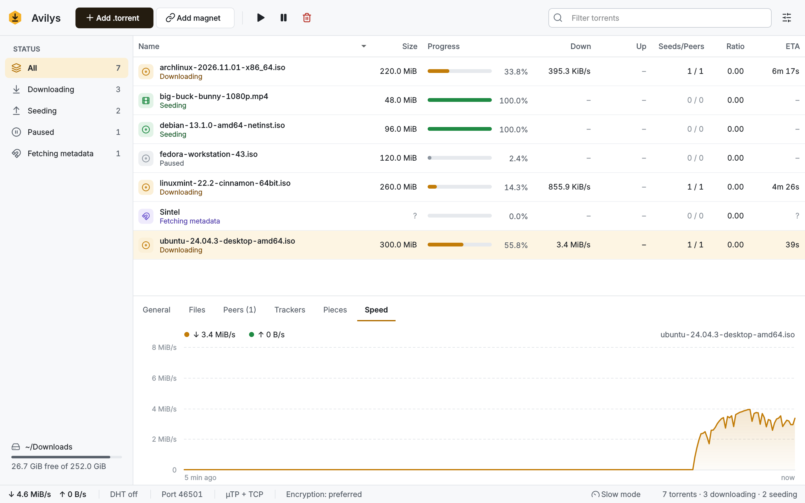
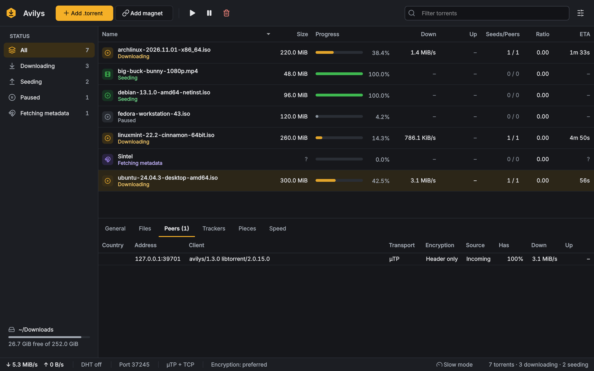
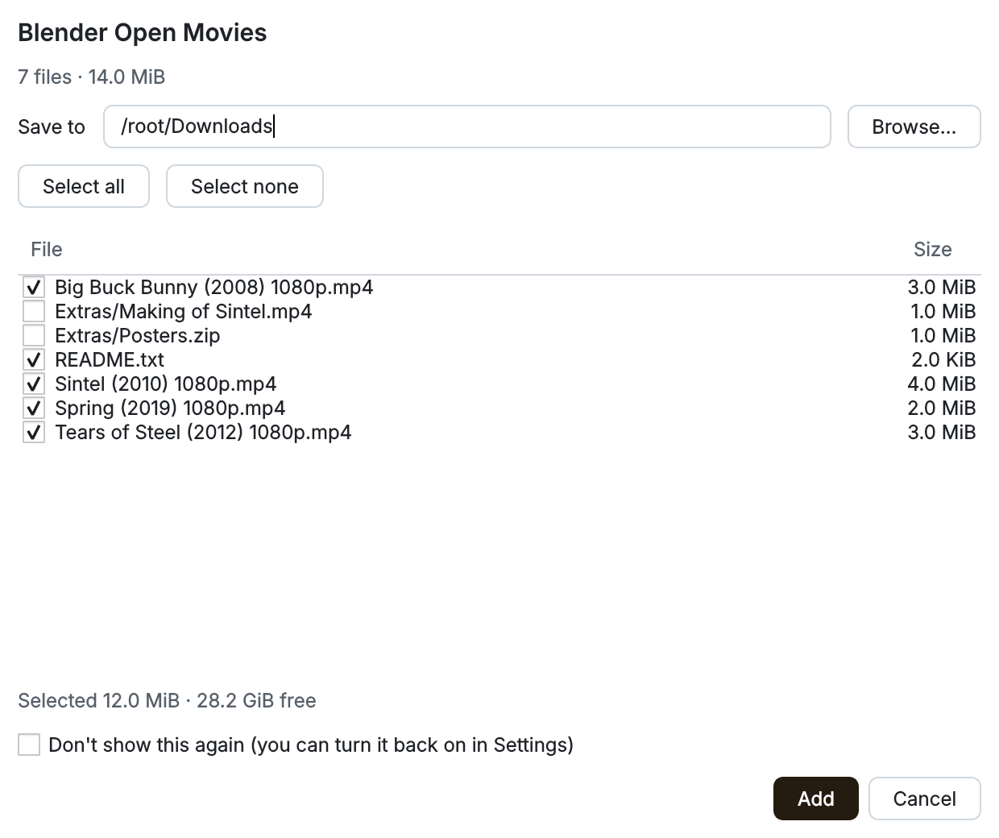

# Avilys

Avilys (Lithuanian for "beehive") is a small BitTorrent client built on [libtorrent](https://libtorrent.org) (the
Python bindings), with a desktop window (Qt) and a terminal mode. It adds
`.torrent` files and magnet links, shows live progress, seeds when a download
finishes, and picks up where it left off after a restart.



libtorrent does the protocol work, so you get these without extra code:

- **DHT** to find peers without trackers, plus PEX and local peer discovery (LSD)
- **µTP** alongside TCP (µTP is the UDP transport that backs off when the link is busy)
- **Protocol encryption** (MSE/PE), set to `prefer`, `require` or `disable`
- **UPnP / NAT-PMP** port mapping
- Resume data: on a restart torrents are not re-checked or re-fetched, magnets included

## Install

**Windows:** download `avilys-<version>-setup.exe` and run it. No admin rights
are needed. During setup you can choose whether Avilys opens magnet links and
`.torrent` files.

**Linux:** download `avilys-<version>-x86_64.AppImage`, make it executable
(`chmod +x`) and run it.

**Default app:** to have Avilys open magnet links and `.torrent` files (for
example if you unticked the boxes during setup), use **Settings → General →
Default app**. On Linux this also adds Avilys to your applications menu. On
Windows, if you'd already picked another app in Windows Settings, Windows asks
you to confirm the change there, and the button takes you to the right page.

Both files are built by GitHub Actions on every push. Download them from the
run's **Artifacts**; they're kept for 7 days. Pushing a `v*` tag attaches them
to a GitHub Release, which keeps them for good.

**From source** (needs Python 3.10 or newer):

```bash
python3 -m venv .venv && . .venv/bin/activate
pip install -e '.[gui]'        # desktop window; use '.[dev]' for tests too
```

### Building the installers yourself

```bash
pip install -r packaging/requirements-build.txt && pip install --no-deps .
python packaging/make_icons.py                  # icon drawn in code -> .png / .ico
pyinstaller packaging/avilys.spec --noconfirm  # -> dist/avilys/
```

Then run `packaging/linux/build-appimage.sh 0.1.0 path/to/appimagetool` on
Linux, or `iscc /DAppVersion=0.1.0 packaging\windows\avilys.iss` on Windows
with Inno Setup 6. To check a build, run `avilys --self-test`: it starts the
engine and window headless and exits with status 0 if they work.

## Desktop window

```bash
avilys-gui                    # or: avilys gui
```

**Adding torrents**
- Add .torrent (Ctrl+O) or Add magnet (Ctrl+U, pre-filled from the clipboard),
  or drag files and links onto the window. Clicking a magnet link in your
  browser works too, and goes to the open window.
- A dialog asks where to save and which files to download, with the selected
  size and free space shown. For magnet links, the file choice appears as soon
  as the file list arrives from peers, and nothing downloads before that.
- **Watch folder:** `.torrent` files that land in a chosen folder are added
  automatically.

**Watching them**
- A status sidebar with live counts, a search box, and a sortable table with
  progress bars.
- **Detail tabs:**
  - **General:** sizes, ratio, availability, and the magnet link.
  - **Files:** double-click a file to open it; right-click for **Open**,
    **Show in folder**, or to skip files and raise their priority.
  - **Peers:** each peer's **country and flag**, client, µTP/TCP, encryption,
    and how it was found.
  - **Trackers:** add, remove, or announce now.
  - **Pieces:** a map of the pieces you have.
  - **Speed:** a 5-minute graph for all torrents or the selected one.
- A notification when a download finishes. Closing the window keeps Avilys
  running in the **tray**; quit from the tray menu or with Ctrl+Q.
- **Errors:** a torrent stopped by a problem (a full disk, a folder Avilys
  can't write to, missing files) shows as **Error**, with the reason in its
  tooltip and in the General tab. The sidebar has an **Errors** filter, and
  you get one notification. Fix the problem, then press **Try again** (or
  Resume).
- **Status bar:** speeds, DHT, and the port with whether it is **reachable**.
  "Reachable" appears once a peer has connected to you from outside; "no
  incoming connections" appears after a few minutes with peers but none
  connecting in, which usually means the port is closed on your router.
  Avilys works this out from its own connections and contacts no outside
  service.
- The window remembers its size, position, column widths, sort order and the
  open detail tab.
- **New versions:** once a day Avilys checks whether a newer release is out.
  If there is one, a pop-up offers to open its download page on GitHub, or to
  skip that version. Nothing is downloaded or installed automatically. Turn
  it off, or check right away, in Settings → General → Updates.

**Right-click a torrent:** Try again (after an error), Open folder, Move to…,
Copy magnet link, Download in order (for previewing videos), Speed limits…,
Check files again, Announce now, Pause/Resume, Remove.

**About** (F1, the tray menu, or the button in Settings): version, credits, and
the poem *Seven Seas* by KS.

**Settings** (Ctrl+,), in tabs:
- **General:** save folder, watch folder, the add dialog, the tray, the theme
  (system, light or dark) and the **language** (English or Lithuanian; a
  change applies the next time Avilys starts). Also:
  - **Unfinished downloads in their own folder:** files move to the save
    folder when a download completes.
  - **Start when you sign in,** hidden in the tray.
  - **Keep the computer awake while downloading** (on by default). Sleep is
    allowed again as soon as nothing is downloading; seeding alone doesn't
    keep it awake.
- **Connection:** port, encryption, DHT/µTP/LSD/UPnP, and **binding to one
  network adapter**. Pick your VPN and transfers stop if it drops, instead of
  leaking out over your normal connection.
- **Speed:** limits, plus **slow mode**: lower limits you can switch on from
  the status bar or on a daily schedule.
- **Queue & seeding:** how many torrents download and seed at once, and stop
  seeding at a ratio or after a number of hours.
- **Privacy:** an IP blocklist (P2P, eMule .dat or CIDR lists, gzipped or not),
  whether to show peer countries, and **anonymous mode**. Anonymous mode stops
  telling peers and trackers that you use Avilys and which version. It does
  not hide your IP address (use a VPN for that), and some private trackers
  refuse programs they can't identify.

<p>
  
  
</p>

## Terminal mode

```bash
# download (and then seed) a magnet link and a .torrent file
avilys start 'magnet:?xt=urn:btih:…' ~/Downloads/some.torrent -d ~/Downloads

# just resume everything from last time
avilys start

# download, seed until ratio 1.0, then exit (handy in scripts)
avilys start some.torrent --seed-ratio 1.0 --exit-when-done

# only accept encrypted peers, cap upload at 500 KiB/s
avilys start --encryption require --max-up 500

avilys list               # saved torrents, without starting anything
avilys remove 656c2093    # forget a torrent (its files are kept)
```

Ctrl+C (or SIGTERM) shuts down cleanly: resume data for every torrent and the
DHT routing table are written to `~/.local/share/avilys/` (this follows
`$XDG_DATA_HOME`, and `--state-dir` overrides it).

Run `avilys start --help` to see every option, including `--port`,
`--no-dht`, `--no-utp`, `--no-lsd`, `--no-port-mapping` and `--max-down`.

## Layout

| File | What it does |
| --- | --- |
| `src/avilys/engine.py` | libtorrent session setup, adding torrents, alert loop, resume data |
| `src/avilys/display.py` | the status table (plain ANSI, no curses) |
| `src/avilys/cli.py` | argument parsing and the main loop |
| `src/avilys/config.py` | settings saved between runs (used by the GUI) |
| `src/avilys/i18n.py`, `src/avilys/translations/lt.py` | translations: `tr("text")` in the code, Lithuanian in `lt.py` |
| `src/avilys/power.py` | keeps the computer awake while downloading |
| `src/avilys/gui/` | the Qt window: `app.py` (window), `models.py` (table), `details.py` (tabs), `widgets.py` (graph, pieces, flags), `dialogs.py` (settings), `add_dialog.py`, `theme.py`, `single.py` (one window at a time), `autostart.py` (start with the system) |
| `src/avilys/geoip.py` | peer IP to country, with the monthly database refresh |
| `packaging/` | PyInstaller spec, icon generator, AppImage script, Inno Setup script |
| `.github/workflows/build.yml` | tests, then the Windows installer and Linux AppImage, each self-tested |
| `tests/test_engine.py` | end-to-end tests: two real sessions on loopback seed to each other |
| `tests/test_gui.py` | drives the real window offscreen: downloads, filters, the add dialog, file picker, flags, graph, settings |
| `tests/test_extras.py` | country lookups, blocklists, slow mode and its schedule, interface binding, trackers |
| `tests/test_i18n.py` | every string has a Lithuanian translation, and none reaches the window untranslated |

## Tests

```bash
pytest
```

The tests need no internet and no display (the GUI test runs Qt offscreen).
Two sessions transfer a file over loopback, and the tests check:

- TCP+µTP, µTP only, TCP only, required encryption (they assert the peer link
  really is RC4) and encryption disabled
- the desktop window, run offscreen: download, filters, Files tab, pause and
  resume, live settings, and remove (files kept)
- resume data surviving a restart
- a magnet link being saved before its metadata arrives

### Translating

Text in the code is English, wrapped in `tr("…")` (or `trn()` for plurals).
`src/avilys/translations/lt.py` maps each English text to Lithuanian. When you
add or change text, `pytest tests/test_i18n.py` lists what is missing from
`lt.py`, and also catches text given to the window without `tr()`. To add a
language, copy `lt.py`, translate it, and add its code to `LANGUAGES` in
`i18n.py`.

Still in English in the Lithuanian window: country names in the Peers tab,
messages that come from libtorrent itself (the event log and unusual errors),
and file dialogs drawn by Windows, which follow the Windows language.

See [ROADMAP.md](ROADMAP.md) for what comes next.

## Code signing policy

Free code signing provided by [SignPath.io](https://about.signpath.io),
certificate by [SignPath Foundation](https://signpath.org).

Windows installers are built from this repository's source by GitHub
Actions (`.github/workflows/build.yml`) and signed only when a release is
published. Nothing built on a personal computer is signed.

Team roles:

- **Authors and committers:** [anglasligonis](https://github.com/anglasligonis)
- **Reviewers:** [anglasligonis](https://github.com/anglasligonis)
- **Approvers** (who approve each signing request): [anglasligonis](https://github.com/anglasligonis)

## Privacy

Avilys has no accounts, no analytics and no telemetry, and it doesn't send
anything about you or your computer to the authors. Settings, the torrent
list and resume data stay in Avilys' folder on your computer.

Avilys connects to the internet only for the following:

- **BitTorrent:** to download and share the torrents you add, it connects
  to other peers, to the torrents' trackers, and to the DHT network. These
  can see your IP address, as with any BitTorrent client. Anonymous mode
  (Settings → Privacy) stops telling them which program and version you
  use; it does not hide your IP address.
- **Your router and local network:** when UPnP / NAT-PMP is on, Avilys asks
  your router to open its port, and local peer discovery looks for peers on
  your own network. Both can be turned off in Settings → Connection.
- **Update check:** once a day, Avilys asks GitHub's public API for the
  latest Avilys release. The request contains only the word "Avilys", and
  GitHub sees your IP address. Turn off **Tell me when a new version is
  out** in Settings → General to stop it.
- **Country database:** about once a month, Avilys downloads DB-IP's free
  country database from `download.db-ip.com`, to show peer countries. The
  request contains only the file name and the word "Avilys". Turn off
  **Show peer countries** in Settings → Privacy to stop it.

## Licence

Avilys is released under the [MIT licence](LICENSE).

## Credits

- [libtorrent](https://libtorrent.org) by Arvid Norberg and contributors does
  the BitTorrent work.
- Country lookups use **IP Geolocation by [DB-IP](https://db-ip.com)**, the
  free IP to Country Lite database, licensed
  [CC BY 4.0](https://creativecommons.org/licenses/by/4.0/). Installers include
  a copy, and Avilys refreshes it about once a month (you can turn this off in
  Settings → Privacy).
- Flags are from [flag-icons](https://github.com/lipis/flag-icons) (MIT),
  pre-rendered to small images; see `src/avilys/gui/flags/LICENSE`.
- The interface is built with [Qt for Python (PySide6)](https://doc.qt.io/qtforpython/).
- The Windows installer's Lithuanian text is Inno Setup's user-contributed
  translation by Robertas Rimas; see `packaging/windows/Lithuanian.isl.LICENSE.txt`.
